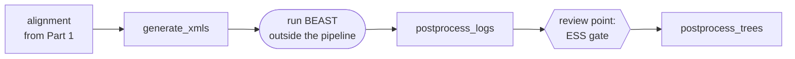

# BDBV Phylodynamics Pipeline (Part 2)

**Generate BEAST XMLs and postprocess BEAST output for Bundibugyo ebolavirus (BDBV) phylodynamics**

A [Nextflow](https://www.nextflow.io/) pipeline that picks up where the [BDBV phylogenetic pipeline (Part 1)](https://github.com/artic-network/bdbv-genepi-nf) leaves off. It takes the final alignment from Part 1 and generates [BEAST](https://beast.community/) XML files from it, and once BEAST has been run, it combines the logs, checks that the chains have converged and prepares the trees. BEAST itself is run outside this pipeline, between the two stages. Every step runs in a Docker container by default. Based on [this](https://github.com/pekarj/bdbv-pipeline-part2) original python pipeline.

## Running with GLACIER

This pipeline has been designed to be run in the interactive [GLACIER](https://github.com/ARTIC-Kraemer-Lab/GLACIER) GUI.

## Pipeline overview

The pipeline has two stages, which you use one after the other, with BEAST run in between:

1. **Generate BEAST XMLs** *(`generate_xmls`, with `--alignment`)* — swap the alignment into the templates, update the SkyGrid parameters, adjust the operator weights for the dataset size and set the chain length and logging interval. One XML is made for each template.
2. **Run BEAST** — run BEAST on the XMLs yourself, outside this pipeline.
3. **Postprocess logs** *(`postprocess_logs`, with `--beast_dir`)* — combine the chain logs, remove the burnin and check the effective sample size (ESS) of the key parameters (**review point**: the ESS gate).
4. **Postprocess trees** *(`postprocess_trees`)* — remove the burnin from the trees, resample them to a manageable number and build an MCC tree with [TreeAnnotator](https://beast.community/treeannotator).

Figures and a report are not part of the pipeline yet.



## Output files

All outputs are written under `--outdir`, one folder per step:

| Folder | Contents |
|--------|----------|
| `beast_xml/` | The generated BEAST XMLs, one per template, named like `<prefix>.n<sequences>.GTR_SG.xml` |
| `postprocess_logs/` | The combined log (`<prefix>.combined.log`), the ESS report (`<prefix>.ess_report.txt`) and `ess_status.txt` (`pass` or `low`) |
| `postprocess_trees/` | The trees with burnin removed (`<prefix>.burninRemoved.trees`), the resampled trees (`<prefix>.burninRemoved.resampled.trees`) and the MCC tree (`<prefix>.mcc.tree`, if TreeAnnotator ran successfully) |
| `execution/` | Nextflow timeline, report and trace |

## Parameters

Parameters are given on the command line as `--name value`. See `nextflow_schema.json` for the full definitions. Give `--alignment` to generate XMLs, `--beast_dir` to postprocess BEAST output, or both.

### Input options

| Parameter | Description | Default |
|-----------|-------------|---------|
| `--alignment` | Final alignment from Part 1 (for example `07_final/<prefix>.ADAR_masked.final.aln`). Generates the BEAST XMLs | |
| `--beast_dir` | Folder containing the BEAST `.log` and `.trees` files. Runs the postprocessing | |

### Output options

| Parameter | Description | Default |
|-----------|-------------|---------|
| `--outdir` | Folder for all output files | `output` |
| `--prefix` | Prefix for output file names | `bdbv_<run_name>` |
| `--run_name` | Label used in the default prefix | today, `YYYYMMDD` |

### BEAST XML options

One XML is generated for each template given. Pass your own file to use a custom template (for example `--template_sg my_skygrid.xml`), or `false` to skip one of the defaults (for example `--template_egc false`).

| Parameter | Description | Default |
|-----------|-------------|---------|
| `--template_sg` | SkyGrid coalescent template (uses `--anchor_date`) | `templates/GTR_SG.template.xml` |
| `--template_mat` | MAT (mutation-annotated tree) SkyGrid template, e.g. `templates/GTR_SG_MAT.template.xml` (uses `--anchor_date`) | off |
| `--template_egc` | Exponential growth coalescent template | `templates/GTR_EGC.template.xml` |
| `--template_lgc` | Logistic growth coalescent template, e.g. `templates/GTR_LGC.template.xml` | off |
| `--anchor_date` | SkyGrid anchor date: the grid extends from this date to the latest sample (`YYYY-MM-DD`) | `2025-11-08` |
| `--chain_length` | MCMC chain length | `500000000` |
| `--log_every` | Log sampling interval | `50000` |

### Postprocessing options

| Parameter | Description | Default |
|-----------|-------------|---------|
| `--burnin` | Fraction of samples (and trees) discarded as burnin | `0.1` |
| `--resample` | Target number of trees after resampling | `1000` |
| `--min_ess` | Minimum ESS for the key parameters | `200` |
| `--force_low_ess` | Carry on to the trees even if a key parameter has a low ESS (see [the ESS gate](#manual-review-point-the-ess-gate)) | `false` |
| `--treeannotator` | TreeAnnotator executable used for the MCC tree | `treeannotator` |

## Data files

- **`templates/`** — the BEAST XML templates (`GTR_SG`, `GTR_SG_MAT`, `GTR_EGC` and `GTR_LGC`), with placeholder taxa and N-filled sequences. The XML step swaps in the alignment and taxa, updates the SkyGrid parameters (weekly grid intervals from the anchor date to the latest sample), adjusts the operator weights for the dataset size and sets the MCMC chain length and logging interval.
- **`data/aliases.csv`** and **`data/health_area_zone_province_slim.csv`** — location lookups copied from Part 1, kept for the figures and report steps that are not implemented yet. The current steps do not use them.

## Command Line Installation

If running on the command line instead of GLACIER, first install [Nextflow](https://www.nextflow.io/) (≥ 23.04) and [Docker](https://www.docker.com/products/docker-desktop), then clone this repository:

```bash
git clone https://github.com/rmcolq/bdbv-pipeline-beast-nf.git
cd bdbv-pipeline-beast-nf
```

No other setup is needed. The pipeline pulls the [`articnetworkorg/bdbv-pipeline-beast`](https://hub.docker.com/r/articnetworkorg/bdbv-pipeline-beast) image from Docker Hub automatically, and it contains everything the pipeline needs, including TreeAnnotator. Docker is the default (`-profile standard`). The image is currently built for `linux/amd64` only. Other options:

| Option | Use |
|--------|-----|
| `-profile singularity` | Run the steps in Singularity instead of Docker |
| `-profile conda` | Create the environment from `environment.yml` rather than using a container. TreeAnnotator comes from the bioconda `beast` package, which is only available for Linux x86-64 and Intel macOS; elsewhere use a container, or install BEAST yourself and give its TreeAnnotator with `--treeannotator` |
| `--wf.container_version TAG` | Use a different image tag, e.g. your own build: `docker build -t articnetworkorg/bdbv-pipeline-beast:dev .` then `--wf.container_version dev` |

## Running the pipeline

### Generate the BEAST XMLs

Take the final alignment from Part 1:

```bash
nextflow run . \
    --alignment data/YYYYMMDD/07_final/BDBV2026.drc.ADAR_masked.final.aln \
    --outdir output/YYYYMMDD \
    --prefix BDBV2026.drc \
    --anchor_date 2025-11-08
```

The XMLs are written to `beast_xml/`. By default one XML is made from each of the SkyGrid and EGC templates. Add `--template_mat templates/GTR_SG_MAT.template.xml` for the MAT SkyGrid template, or `--template_sg false` to skip one.

Then run BEAST on the XMLs yourself, outside this pipeline.

### Postprocess the BEAST output

Once the BEAST runs have finished, give the folder that holds their `.log` and `.trees` files:

```bash
nextflow run . \
    --beast_dir /path/to/beast/output \
    --outdir output/YYYYMMDD \
    --prefix BDBV2026.drc \
    --burnin 0.1
```

Files that the pipeline itself produces (for example `*.combined.log` or `*.burninRemoved.trees`) are ignored if they are in the same folder, so it is safe to rerun.

### Manual review point: the ESS gate

After combining the logs, the pipeline checks the ESS of the key parameters: the posterior, likelihood, prior, tree length, root height, clock rate, growth rate, doubling time, logistic t50 and the SkyGrid and Skyline parameters. If any of them is below `--min_ess` (default 200), the chains have not sampled enough and the pipeline stops before the trees. It prints how to continue when it finishes. Look at `postprocess_logs/<prefix>.ess_report.txt`, then either:

1. **Run more BEAST chains**, add their logs and trees to `--beast_dir` and rerun, or
2. **Continue anyway** by rerunning with `--force_low_ess`, using `-resume` so the completed steps are reused from the cache:

```bash
nextflow run . <same parameters> --force_low_ess -resume
```

Results from chains with a low ESS should be treated with caution.

## Relationship to other repositories

- **[bdbv-genepi-nf](https://github.com/artic-network/bdbv-genepi-nf)** (Part 1) — download, clean, align and build the maximum-likelihood tree. Its final alignment is the input here.
- **[bdbv-pipeline-part2](https://github.com/pekarj/bdbv-pipeline-part2)** — the original Python version of this pipeline, which the Nextflow pipeline is based on.
- **`2026_BDBV_phylogeography`** — phylogeographic analysis (DTA/BSSVS on empirical trees).
